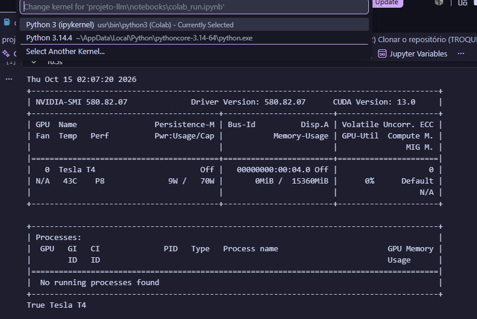
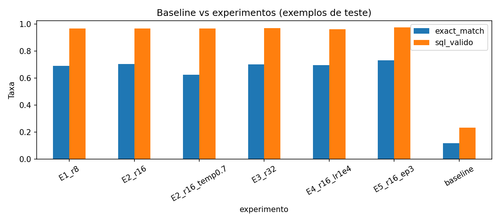
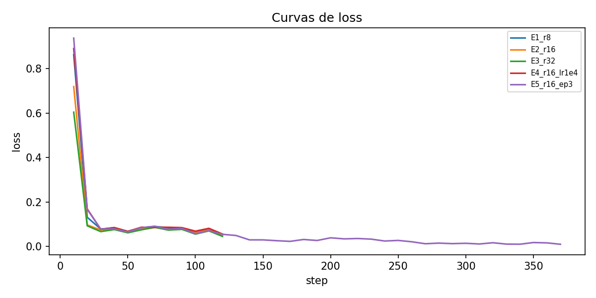
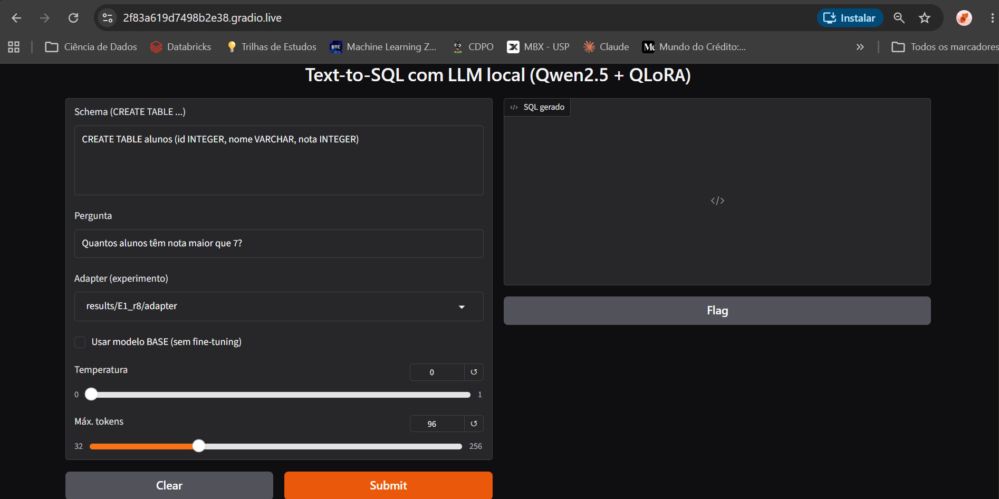
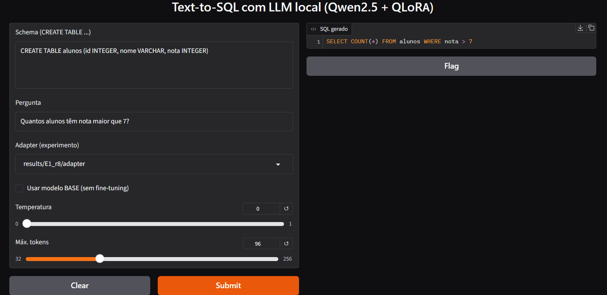
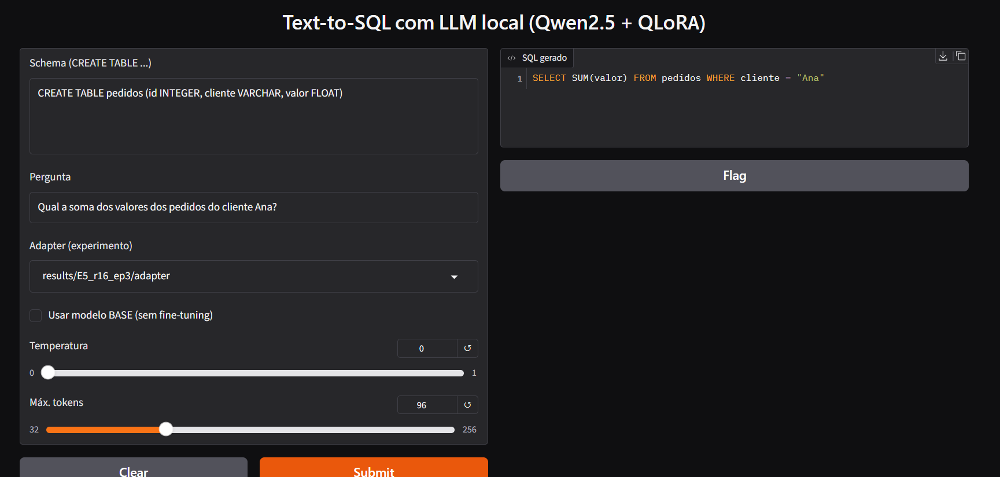

# Text-to-SQL com LLM open-source (Qwen2.5 + QLoRA)

Fine-tuning de uma LLM open-source para converter perguntas em linguagem natural em consultas SQL, com avaliação do modelo, comparação de parâmetros e frontend em Gradio. Todo o treino e as avaliações foram feitos em **GPU**.

**Grupo:** 
- Gabriel Aparecido Cassalho Xavier - RM:99794
- Gustavo Vegi - RM:550188
- Lucas Rodrigues Delfino - RM550196
- Luisa Cristina dos Santos Neves - RM:551889
- Pedro Henrique Silva de Morais - RM:98804

> ### Aviso: GPU remota
> Nenhum integrante do grupo tinha placa de vídeo NVIDIA (necessária para CUDA), então o treino e as avaliações foram executados em uma **GPU remota do Google Colab (Tesla T4)**, conectada ao **VSCode pela extensão oficial do Colab**. As extensões de monitoramento GPU Monitor e GPU Environment leem a GPU local e por isso não se aplicam a esse cenário. A GPU foi monitorada com `nvidia-smi`, executado dentro do notebook no VSCode (print na seção 3).

## 1. Problema
Dado o schema de uma tabela (`CREATE TABLE ...`) e uma pergunta, o modelo gera a consulta SQL correspondente. O problema tem avaliação objetiva e utilidade prática: permitir que pessoas sem conhecimento de SQL consultem dados.

## 2. Modelo
`Qwen/Qwen2.5-1.5B-Instruct`: modelo pequeno, de licença aberta, que cabe em GPUs modestas quando quantizado em 4 bits. Usamos **QLoRA**: o modelo base é carregado em 4-bit e só os adaptadores LoRA são treinados (18,4 milhões de parâmetros, cerca de 1,2% do total de 1,56 bilhão).

## 3. Hardware e evidência de GPU
- **GPU:** NVIDIA Tesla T4, cerca de 15 GB de VRAM (Google Colab, runtime remoto)
- **Ambiente:** notebook `notebooks/colab_run.ipynb` executado no VSCode, com o kernel do Colab
- Versões de driver, CUDA e PyTorch aparecem no print abaixo (saída de `nvidia-smi` e `scripts/check_gpu.py`)



## 4. Estrutura do repositório
```
├── notebooks/colab_run.ipynb   # roteiro de execução (GPU Colab)
├── data/prepare_data.py        # gera train.jsonl e test.jsonl
├── src/
│   ├── train.py                # fine-tuning QLoRA
│   ├── evaluate.py             # exact match e SQL válido
│   ├── experiments.py          # grade de experimentos
│   ├── summary.py              # tabela e gráficos
│   └── common.py
├── app/app.py                  # frontend Gradio
├── scripts/check_gpu.py        # verificação da GPU
├── results/                    # resultados dos experimentos
└── docs/                       # prints, gráficos e guias de configuração
```

## 5. Como executar

### Google Colab no VSCode (o que usamos)
1. Instale no VSCode as extensões **Jupyter** e **Colab**.
2. Abra `notebooks/colab_run.ipynb`, escolha o kernel **Colab > New Colab Server** e selecione **GPU T4**.
3. Execute as células em ordem: verificação da GPU, dependências, dados, treino e avaliação, frontend. Mais detalhes em `docs/SETUP_COLAB.md`.

> Os adaptadores treinados **não estão no repositório** (são ignorados pelo `.gitignore`). Para abrir o frontend é preciso treinar antes pelo menos um experimento, por exemplo:
> `python src/train.py --name E2_r16 --n_train 2000 --bs 4`

## 6. Dataset e prompt
Dataset: [`b-mc2/sql-create-context`](https://huggingface.co/datasets/b-mc2/sql-create-context) (derivado de WikiSQL e Spider), em inglês. Embaralhamos com semente fixa (42) e separamos 200 exemplos de teste, sem sobreposição com o treino. Para o treino foram usados **2000 exemplos**, para que a grade completa coubesse no tempo disponível na GPU gratuita.

Formato do prompt: `### Schema / ### Pergunta / ### SQL`. A loss é calculada apenas sobre a resposta (SQL), não sobre o prompt.

## 7. Experimentos
Variamos o **rank do LoRA**, a **taxa de aprendizado**, o **número de épocas** e a **temperatura de geração**, mantendo o batch efetivo em 16. O baseline é o modelo base, sem fine-tuning, avaliado nos mesmos 200 exemplos de teste.

| Experimento | Rank | LR | Épocas | Temperatura |
|---|---|---|---|---|
| Baseline | - | - | - | 0 |
| E1 | 8 | 2e-4 | 1 | 0 |
| E2 | 16 | 2e-4 | 1 | 0 |
| E3 | 32 | 2e-4 | 1 | 0 |
| E4 | 16 | 1e-4 | 1 | 0 |
| E5 | 16 | 2e-4 | 3 | 0 |
| E2 + temperatura | 16 | 2e-4 | 1 | 0.7 |

## 8. Resultados
Resultados completos em [`results/summary.csv`](results/summary.csv) e [`results/tabela.md`](results/tabela.md); as respostas de cada modelo estão em `results/eval_*.json`.

| experimento    |   rank |       lr |   epocas |   temperatura |   loss_final |   tempo_treino_s |   vram_pico_gb | exact_match   | sql_valido   |
|:---------------|-------:|---------:|---------:|--------------:|-------------:|-----------------:|---------------:|:--------------|:-------------|
| E1_r8          |      8 |   0.0002 |        1 |           0   |       0.0735 |            525.3 |           2.82 | 69.0%         | 96.5%        |
| E2_r16         |     16 |   0.0002 |        1 |           0   |       0.0681 |            518.8 |           2.96 | 70.5%         | 96.5%        |
| E2_r16_temp0.7 |     16 |   0.0002 |        1 |           0.7 |       0.0681 |            518.8 |           2.96 | 62.5%         | 96.5%        |
| E3_r32         |     32 |   0.0002 |        1 |           0   |       0.0644 |            529.1 |           3.25 | 70.0%         | 97.0%        |
| E4_r16_lr1e4   |     16 |   0.0001 |        1 |           0   |       0.0755 |            521.8 |           2.96 | 69.5%         | 96.0%        |
| E5_r16_ep3     |     16 |   0.0002 |        3 |           0   |       0.013  |           1564.2 |           2.96 | 73.0%         | 97.5%        |
| baseline       |    nan | nan      |      nan |           0   |     nan      |            nan   |         nan    | 12.0%         | 23.5%        |





### Métricas
- **Exact match:** a query gerada é igual à esperada depois de normalizar (minúsculas, espaços e aspas).
- **SQL válido:** a query é aceita pelo SQLite (`EXPLAIN`) usando o schema do exemplo.
- **Limitações das métricas:** o exact match penaliza queries equivalentes escritas de outra forma, e a validade não garante que a resposta esteja correta, porque as tabelas não têm dados.

## 9. Análise dos resultados
(Escrever aqui, com base na tabela: efeito do fine-tuning contra o baseline, influência do rank, da taxa de aprendizado e das épocas, efeito da temperatura, e custo em tempo de treino e VRAM.)

### Exemplos qualitativos
Comparação do modelo base e do fine-tunado (E2) em 10 exemplos do teste, em [`results/exemplos.md`](results/exemplos.md).

| Pergunta | Esperado | Base | Fine-tuned |
|---|---|---|---|
| When Essendon played away; where did they play? | `SELECT venue FROM table_name_50 WHERE away_team = "essendon"` | `SELECT venue FROM table_name_50 WHERE away_team = 'Essendon'` | `SELECT venue FROM table_name_50 WHERE away_team = "essendon"` |
| What is the lowest numbered game against Phoenix with a record of 29-17? | `SELECT MIN(game) FROM table_name_61 WHERE opponent = "phoenix" AND record = "29-17"` | ````sql SELECT MIN(game) FROM table_name_61 WHERE opponent = 'Phoenix' AND record = '29-17'` | `SELECT MIN(game) FROM table_name_61 WHERE opponent = "phoenix" AND record = "29-17"` |
| Who did the Texan's play on Week 4? | `SELECT opponent FROM table_name_37 WHERE week = "4"` | `SELECT opponent FROM table_name_37 WHERE week = 'Week 4' AND team = 'Texas'` | `SELECT opponent FROM table_name_37 WHERE week = "week 4"` |
| Which Points have Touchdowns larger than 0, and an Extra points smaller than 0? | `SELECT SUM(points) FROM table_name_70 WHERE touchdowns > 0 AND extra_points < 0` | ````sql SELECT AVG(points) FROM table_name_70 WHERE touchdowns > 0 AND extra_points < 0` | `SELECT SUM(points) FROM table_name_70 WHERE touchdowns > 0 AND extra_points < 0` |
| What is the name of the player who is Sco and moving to greenock morton in the summer? | `SELECT name FROM table_name_83 WHERE nat = "sco" AND transfer_window = "summer" AND moving_to = "greenock morton"` | ````sql SELECT name FROM table_name_83 WHERE moving_to = 'greenock morton' AND nat = 'Sco' AND transfer_window LIKE '%summer%' ```` | `SELECT name FROM table_name_83 WHERE moving_to = "greenock morton" AND nat = "scotland" AND transfer_window = "summer"` |
| Of all the contestants who got voted, what is the contestant number and name of the contestant who got least votes? | `SELECT T1.contestant_number, T1.contestant_name FROM contestants AS T1 JOIN votes AS T2 ON T1.contestant_number = T2.contestant_number GROUP BY T1.contestant_number ORDER BY COUNT(*) LIMIT 1` | `SELECT contest.contestant_number, cont.name FROM contestants AS cont JOIN votes AS vote ON cont.contestant_number = vote.contestant_number WHERE vote.vote_count = ( SELECT MAX(vote_count) FROM votes ) ORDER BY vote.vote_count LIMIT 1` | `SELECT T1.contestant_number AS "Contestant Number", T2.contestant_name AS "Name" FROM contestants AS T1 JOIN votes AS T2 ON T1.contestant_number = T2.contestant_number ORDER BY T2.votes LIMIT 1` |
| Which venue had the result 7-1? | `SELECT venue FROM table_name_50 WHERE result = "7-1"` | ````sql SELECT venue FROM table_name_50 WHERE result = '7-1'` | `SELECT venue FROM table_name_50 WHERE result = "7-1"` |
| What did the tournament that got an A in 1945 get in 1949? | `SELECT 1949 FROM table_name_22 WHERE 1945 = "a"` | ````sql SELECT 'A' AS result FROM dual` | `SELECT COUNT(Id) FROM table_name_22 WHERE Id = "tournament"` |
| Find the states where have the colleges whose enrollments are less than the largest size. | `SELECT DISTINCT state FROM college WHERE enr < (SELECT MAX(enr) FROM college)` | ````sql SELECT state FROM college WHERE enr < (SELECT MAX(enr) FROM college)` | `SELECT state FROM college WHERE enr < (SELECT MAX(enr) FROM college)` |
| What is the name of the episode that had 9.89 million U.S. viewers? | `SELECT title FROM table_24648983_1 WHERE us_viewers__million_ = "9.89"` | ````sql SELECT title FROM table_24648983_1 WHERE us_viewers__million_ = '9.89' ```` | `SELECT title FROM table_24648983_1 WHERE us_viewers__million_ = "9.89"` |

## 10. Frontend
Interface em Gradio (`app/app.py`) em que o usuário informa o schema e a pergunta, escolhe o experimento (adaptador), pode comparar com o modelo base e ajusta temperatura e tamanho máximo da resposta. Como a GPU é remota, o app foi executado no Colab com `GRADIO_SHARE=1`, que gera um link público temporário.



**Teste 1**



**Teste 2**



## 13. Referências
- Hu et al., *LoRA: Low-Rank Adaptation of Large Language Models* (2021)
- Dettmers et al., *QLoRA: Efficient Finetuning of Quantized LLMs* (2023)
- Hugging Face `transformers`, `peft`, `bitsandbytes`, `datasets`
- Qwen2.5 (`Qwen/Qwen2.5-1.5B-Instruct`)
- Dataset `b-mc2/sql-create-context`
